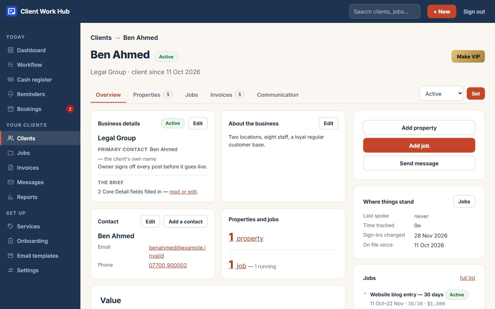
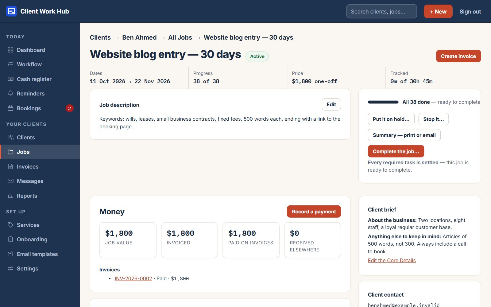
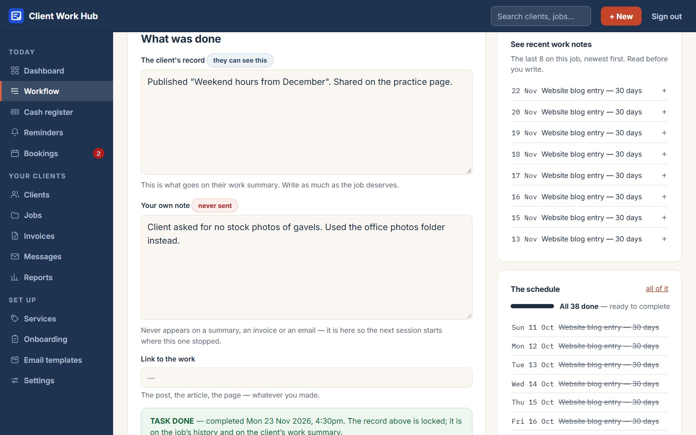
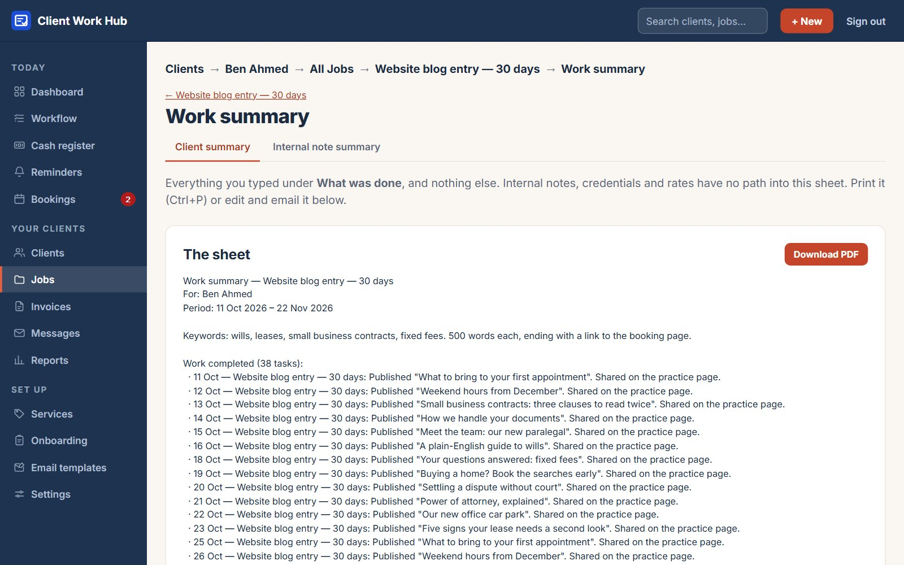
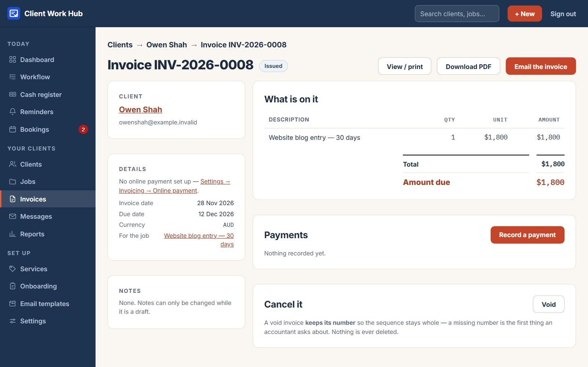
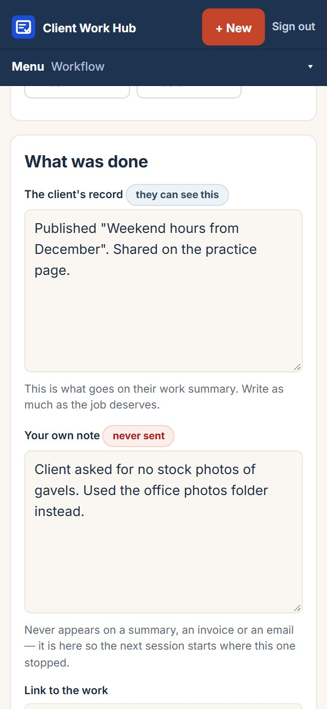
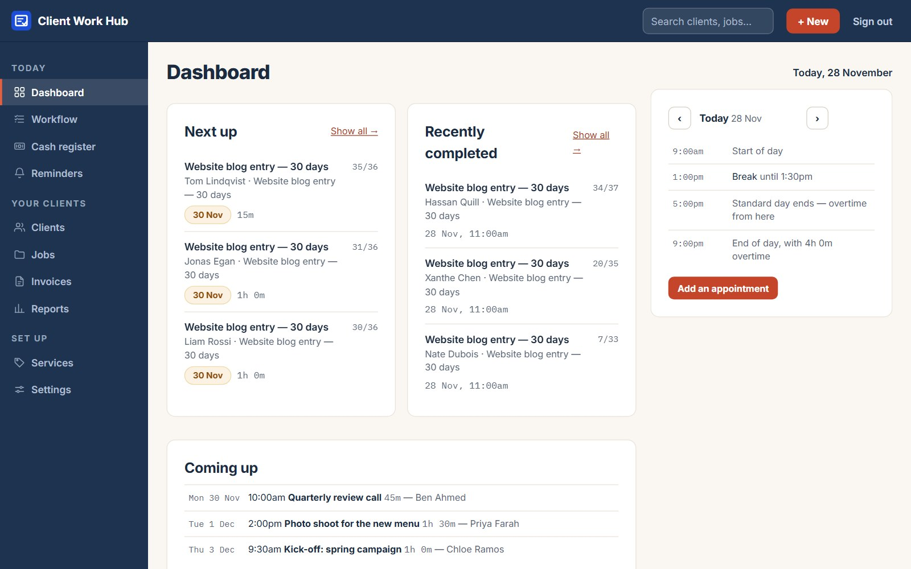

# Client Work Hub

**Run the work for all your clients from one place, and send each of them a
clear report of what you did at the end of the month.**

## Who it's for

Freelancers and small agencies who do ongoing work for several clients:
websites, social media, content, maintenance, or work that takes you to the
client's door. It is for the work *after* the sale, month after month.

## Pick your edition

Both are free, and both are the same software.

| Web edition | Windows home edition |
|---|---|
| Needs hosting with **PHP 8.1+ and MySQL or MariaDB**, such as ordinary cPanel hosting. | Runs on **one Windows 10 or 11 PC**. Nothing to host, nothing else to install. |
| You open it from any browser, on any device, including your phone. | It opens in its own window on that PC and answers only there. |
| Clients get their own page by private link: summaries, sign-off, rebooking, invoices. Email to clients, and card or PayPal payments. | No client portal, no email and no online payments. Invoices and summaries are PDFs you save and send yourself. |
| Download `clientworkhub-x.y.z.zip` | Download `clientworkhub-home-x.y.z.zip` |

## What it does

**Every client on one page.** Their brief, their websites and accounts, their
jobs and their whole history. Passwords you keep for them are stored
encrypted.

**Repeat work that schedules itself.** Set a job up once, with how long each
task takes and how often (daily, weekly or monthly), and it writes the days
for you. Save the work you sell as a service and start the next one in a
click.

**Two notes on every task.** One the client sees, one they never do. The
client's brief and standing instructions show on every task, so you never
start cold.

**End-of-month reports, done for you.** When a job finishes, or at the end of
each month for monthly work, it puts your client notes together into a
day-by-day summary. Send it as a PDF or, on the web edition, as a private link
the client can sign off or reply to.

**Invoices.** Raise an invoice from a job, print it or save it as a PDF, and
record payments. On the web edition clients can pay by card (Stripe) or
PayPal.

**On your phone.** The web edition works on a phone as well as a desktop, so
you can tick off a task where you did it.

**Windows home edition.** The same screens on one PC, without the parts that
reach a client.

Also included: time tracking, profit per client, reminders and follow-ups,
appointments and reports, plus onboarding forms and a booking page on the web
edition.
[Everything it does](FEATURES.md).

## Install

**Download the right zip.** Take it from the
[Releases page](https://github.com/Matthew4509/clientworkhub/releases), under
*Assets*. Not the green **Code** button and not the *Source code* zips: those
wrap everything in an extra folder and are not the signed package.

**Web edition on cPanel**

1. *MySQL® Databases*: create a database and a user, and give the user
   **ALL PRIVILEGES** on it.
2. *File Manager*: make a folder such as `public_html/hub`, upload
   `clientworkhub-x.y.z.zip` into it and **Extract**.
3. Open `yoursite.com/hub/install.php` straight away and fill in the one
   form. It writes the settings, builds the database, creates your account
   and deletes itself.
4. Turn on two-step sign-in.

Full guide, including other hosts and nginx: [INSTALL.md](INSTALL.md#installing-on-cpanel-hosting).

**Windows home edition**

1. Download `clientworkhub-home-x.y.z.zip`, right-click it and choose
   **Extract All**.
2. In the folder it makes, open the **Client Work Hub x.y.z** folder and
   double-click **Install Client Work Hub.cmd**. It installs for your Windows
   user only. If the PC lacks Microsoft's Visual C++ Runtime, setup offers to
   install it first.
3. Open **Client Work Hub** from the Start menu.

Full guide: [INSTALL.md](INSTALL.md#on-one-windows-pc-the-home-edition).

**Current version: 0.3.26.** Updates install from Settings > Update, after the
release's signature is checked.

## Your data stays yours

- No sign-up and no company in the middle: it runs on your own hosting or
  your own PC, and your data stays there.
- Client passwords are encrypted with a key that is never kept in the
  database, and every time one is shown it is written to a log first.
- Two-step sign-in, signed updates and encrypted backups.
  [How it is protected](SECURITY.md).

## Licence

Free to use for your own business, with no client limit: install it, run
your business on it, change it. You may not sell it or offer a product that
competes with it. It comes with no warranty.

Licence: [PolyForm Shield 1.0.0](LICENSE) · Third-party parts:
[THIRD-PARTY-NOTICES.md](THIRD-PARTY-NOTICES.md) · Licence history and the
0.3.x free-for-life promise: [LICENSE-NOTES.md](LICENSE-NOTES.md) ·
[The illustrated tour (PDF)](Client-Work-Hub.pdf)
