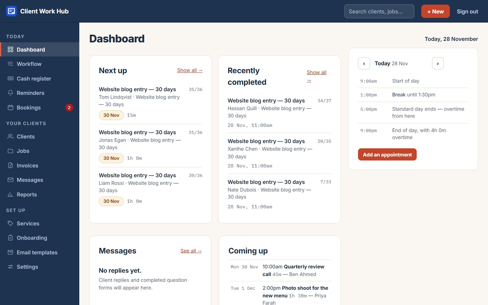

# Client Work Hub

**Run the work for all your clients from one place — and send each of them a
clear report of what you did at the end of the month.**

Client Work Hub is free software for freelancers and small client-service
businesses: anyone doing the work *after* the sale, for more than one client.
Websites, social media, maintenance, content, or work that takes you to the
client's door.

## What it is for

**Many clients, one list.** Every client has one page: their brief, their
websites and accounts, their jobs and their whole history. The dashboard shows
what is due today across all of them, what is late, and how much of the day is
already spoken for.

**Repeat work without the admin.** Set a job up once — how long it takes and
how often, daily, weekly or monthly — and it writes the days itself. Save the
work you sell as a service and start the next one in a click. Every summary
you send carries a link to the client's own page, where they can tell you how
it went and book the same thing again, with no account and no password. A
returning client shows up as a returning client.

**Notes that stay where the work is.** Paste the client's brief onto the job
and it shows on every task. Each task has two notes: one the client sees, one
they never do. Snippets keep the sentences you write every day one click away,
and standing instructions ("never post before 9am") follow the client
everywhere.

**End-of-month reports, done for you.** When a job finishes — for monthly work,
at the end of the month — Client Work Hub puts together a summary of the work,
day by day, from the notes you wrote for the client. Send it as a PDF or a
private link; the client can sign it off or reply on the page, and you see the
answer on their record.

**And the rest, when you want it:** time tracking, profitability per client,
invoices with Stripe or PayPal, reminders and follow-ups, onboarding forms
that collect what you need before you start, and a booking page.

## Your server, your clients' data

There is no account to sign up for and no company in the middle. You put it
on your own hosting — ordinary cPanel is enough — and it stays there. It names
no other website anywhere a client can see.

- Your clients' passwords are encrypted, with the key kept on your server and
  never in the database.
- Every time a password is shown, it is written to a log first.
- Two-step sign-in, signed updates, and encrypted backups.

**Current version: 0.3.25.** Free to use for your own business, with no
client limit. [How to install it](INSTALL.md) · [Everything it does](FEATURES.md)
· [How it is protected](SECURITY.md) · [The illustrated tour (PDF)](Client-Work-Hub.pdf)

## Two editions, one release

- **Web edition** (`clientworkhub-x.y.z.zip`): for your own hosting, as
  described below.
- **Windows home edition** (`clientworkhub-home-x.y.z.zip`): runs on one
  Windows 10 or 11 PC, for one person, with nothing to host. Unzip it and
  double-click **Install Client Work Hub.cmd** in the folder inside it: it
  installs for your Windows user (no administrator, unless the PC lacks
  Microsoft's Visual C++ Runtime: setup offers to install it, and Windows asks
  for permission), adds Client Work Hub to the Start menu, and opens it in its
  own window. It carries its own PHP and MariaDB, answers only on
  that PC, and keeps your data in `%APPDATA%\Client Work Hub`, which
  uninstalling (Settings > Apps) leaves alone. Everything that reaches a
  client or the internet is left out: no client portal or links, no email,
  no Stripe or PayPal, no work screens, no Piano property type. Invoices and
  job summaries are PDFs you save. **Check for updates** (Settings > Update)
  asks GitHub only when you press it, installs a newer release after checking
  its signature, and can go back to the version before.

The two are the same code: one setting in `config.php` (`'edition' =>
'home'`, written only by the Windows home edition when it first starts) turns the web features off on
the server, not just in the menus.

## Download the right zip

Take **`clientworkhub-x.y.z.zip`** from the
[Releases page](https://github.com/Matthew4509/clientworkhub/releases), under
*Assets*. Not the green **Code** button and not the *Source code* zips GitHub
adds to every release: those wrap everything in an extra folder, and they are
not the signed package that Admin → Settings → Update checks.

## Deploying to cPanel

1. cPanel → *MySQL® Databases*: create a database and a user, and add
   the user to it with **ALL PRIVILEGES**.
2. cPanel → *File Manager*: make a folder such as `public_html/hub`,
   upload the release zip into it and **Extract**. The files land directly
   in that folder.
3. Open `yoursite.com/hub/install.php` **straight away** and fill in one
   form. It writes `config.php` (with a generated encryption key), builds the
   database, creates your administrator account and deletes itself.
4. Turn on two-step sign-in.

**[INSTALL.md](INSTALL.md) is the full guide**: choosing the PHP version in
MultiPHP Manager, installing beside an existing website, nginx hosts, and
what to check afterwards.

## Running it locally

Any PHP 8.1+ with `pdo_mysql`, `openssl` and `mbstring`, and any
MySQL 5.7+ / MariaDB 10.3+. There is no build step, no composer and no npm.
XAMPP, Laragon or MAMP work: extract the zip into the web folder and open
`install.php` (see INSTALL.md).

PHP's own server (`php -S localhost:8080`) also runs it, but it does not read
`.htaccess`, so `storage/`, `lib/` and the spooled email are readable over
HTTP while it runs. Use it on your own machine only, never on a network.

## The three security rules that must never be broken

1. **Admin passwords are hashed** (`password_hash`), never encrypted.
2. **Stored client credentials are encrypted** (AES-256-GCM) with a key that
   lives in `config.php` / `storage/appkey.php` — **never in the database**.
   A stolen database dump must decrypt to nothing.
3. **The audit log is append-only.** No screen edits or deletes it, ever.

## Licence

**PolyForm Shield License 1.0.0.** `SPDX-License-Identifier: PolyForm-Shield-1.0.0`
— the full text is in [`LICENSE`](LICENSE), and it is on every source file
this project wrote.

In plain words: it is free. Install it, run your business on it, change it,
share copies of it, all at no cost. What you may not do is sell it or offer a
product that competes with it — repackaging it under another name, selling
copies, or selling it as a hosted service. The `Required Notice:` line at the
top of `LICENSE` has to stay with any copy. It comes with no warranty of any
kind — read the "No Liability" section of `LICENSE`, and mean it: this
software holds passwords that belong to other people.

Releases up to and including 0.3.18 were published under the MIT licence, and
copies of those releases keep the MIT terms they were given under. From
0.3.19 the licence is PolyForm Shield.

Three things inside it are somebody else's work under their own licences —
jsPDF (MIT) and the Inter and IBM Plex Mono font files (SIL Open Font License
1.1). They are listed in [`THIRD-PARTY-NOTICES.md`](THIRD-PARTY-NOTICES.md),
and this project's licence does not cover them.

Separately from the licence, every release numbered **0.3.x is free for life**
to anyone already running it — no fee, no expiry, no licence key, no client
limit.
